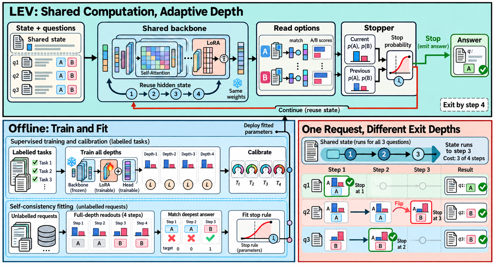

# 插画式科研展示图 · Research Illustration Skill

为论文和 PPT 绘制彩色、对象细节丰富的科研方法示意图。文字精简，图形内容充实：用对象内部结构、成组结果、状态变化与连接关系概括方法。

下图是本流程生成并获用户明确认可的风格样张：

## 适用范围

适合论文方法总览、系统结构图和 PPT 展示配图。它面向最终展示，不承担说明文档、可读性报告或教学讲解的完整解释任务。

## 核心画法

- 协调的浅色分区、统一的深色轮廓与稳定的对象配色。
- 文档、代码、矩阵、网络、样本组和轨迹具有内部细节，图形直接表达机制。
- 短标签，无需默认搬入公式、推导或长段文字；信息密度由对象、关系和变化提供。
- 面积随内容安排，避免无作用空白与局部拥挤；必要的框与丰富色彩均可保留。
- 实际传入风格参考，生成后查看图片并修正科学含义、标签、结果和箭头。
- 风格认可后的修订保留画法，只改相应局部。

样张的三块区域、配色和 LEV 研究内容不固定为其他论文的模板。

## 安装与使用

将 [research-illustration/](research-illustration/) 整个目录放入所用 agent 的 skills 目录，保留相对结构。Codex 用户技能安装位置为 `~/.agents/skills/research-illustration/`。

示例请求：

> 用 $research-illustration 为这篇论文绘制一张用于论文/PPT 的科研展示图。沿用已认可样张的彩色插画风格，用具体对象和状态变化表达机制，标签简短，避免大片空白。

默认使用 Codex 内置图像生成工具，无需单独配置 API key。输出为 PNG 位图；它不等同于逐元素可编辑的 SVG 或 PPT 对象。当前环境需要具备对应图像生成能力；skill 本身不提供生成模型。

## 文件

| 文件 | 用途 |
| --- | --- |
| [SKILL.md](research-illustration/SKILL.md) | 可安装的作图规则与工作流程 |
| [reference-guide.md](research-illustration/references/reference-guide.md) | 参考图观察、迁移边界与实际修订经验 |
| [approved-lev-example.png](research-illustration/assets/approved-lev-example.png) | 已认可的成图风格对照 |
| [assets/](research-illustration/assets/) | 已认可样张与两张原始风格参考 |

原始参考图由用户提供，仅作为视觉参考保留；原作者、绘制软件及授权信息未确认，本仓库不声明拥有这些参考图的版权，也不为其另行授予许可。LEV 样张为基于论文内容制作的示意图，图中分布与实例是机制示意，不是实验测量结果。一次样张的风格认可不代表已验证所有论文上的作图效果。
